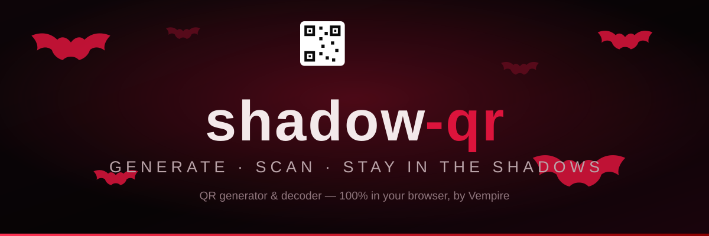

# shadow-qr

A QR code generator & decoder that runs entirely in your browser — no uploads, no tracking, no server.

## Features

- **Generator** — type any text or URL and get a scannable QR code instantly.
  - Error-correction levels L / M / Q / H
  - Custom image size and foreground/background colours
  - One-click PNG download
- **Decoder** — drop in a QR image (or click to pick a file) and read its contents locally via the `BarcodeDetector` API.
  - Copy button for the decoded text
  - Phishing-awareness warning when the decoded content is a URL, naming the destination domain so you can check it before opening
- **Private by design** — encoding and decoding happen on your device. Nothing you type or drop ever leaves the page.
- **From-scratch encoder** — the QR encoder in `app.js` is hand-written: byte mode with UTF-8, automatic version selection (versions 1–10), Reed–Solomon error correction over GF(256), and mask/format/version information per spec. No QR library involved.

## Usage

Open `index.html` in a browser (or serve the folder with any static file server, e.g. `npx serve .`).

1. **Generate:** enter text or a URL, pick an error-correction level, size and colours, then download the PNG.
2. **Decode:** drag a QR image onto the drop zone or click it to choose a file. Decoding needs a Chromium-based browser (Chrome, Edge, Brave…) because it relies on the `BarcodeDetector` API; the generator works in any modern browser.

Encoder limits: byte mode, versions 1–10 — up to 271 bytes at level L, 119 bytes at level H.

## How it works

1. Input text is encoded as UTF-8 bytes and wrapped in byte mode (mode indicator + character count).
2. The smallest version (1–10) that fits the data at the chosen error-correction level is selected automatically.
3. Data codewords are padded, split into blocks, and Reed–Solomon error-correction codewords are computed over GF(256) with primitive polynomial `0x11D`.
4. Blocks are interleaved and placed into the module matrix around the finder, timing and alignment patterns; a mask is applied to data modules, then format (and, for version 7+, version) information is written.
5. The matrix is rendered to a `<canvas>` with a 4-module quiet zone and exported as PNG on download.

## Tests

```sh
node --test
```

The suite covers matrix sizing and automatic version selection, finder/timing/dark-module placement, format and version bit correctness against published values, GF(256) arithmetic, Reed–Solomon output against a published worked example, capacity errors for oversized input, and UTF-8 handling.

## License

MIT — see [LICENSE](LICENSE). Copyright © Lavish Gangwar (Vempire).
